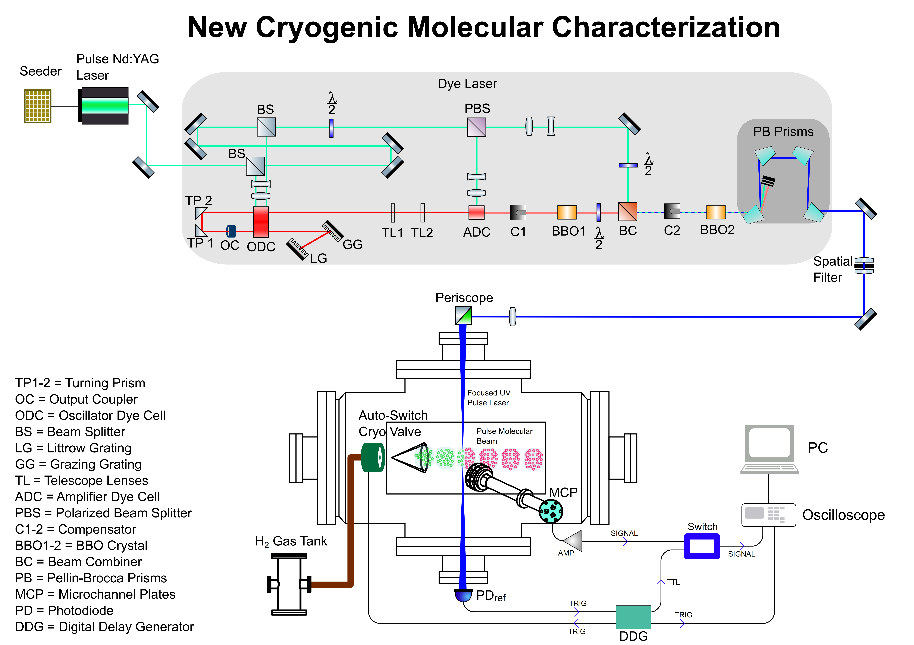

# Molecular Beam Characterization by REMPI UV Pulse Laser

<<<<<<< HEAD
My project is about Molecular Spectroscopy by UV pulse laser. We provides ionized photon as a detection of next level jump from elecron-photon exchange.

Resonance-Enhanced Multi-Photon Ionization (REMPI) spectroscopy provides a powerful approach for sensitive quantum state-selective detection of molecules 
=======
I will add the desc into

Resonance-Enhanced Multi-Photon Ionization (REMPI) spectroscopy provides 
a powerful approach for sensitive quantum state-selective detection of 
molecules
>>>>>>> fee3773 (docs(readme): add intro in desc)



```math
E = mc^2
```


